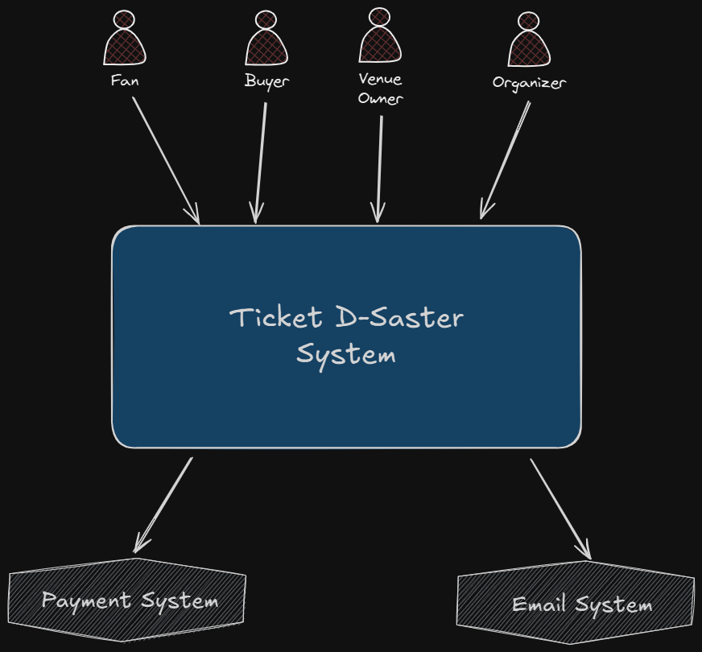
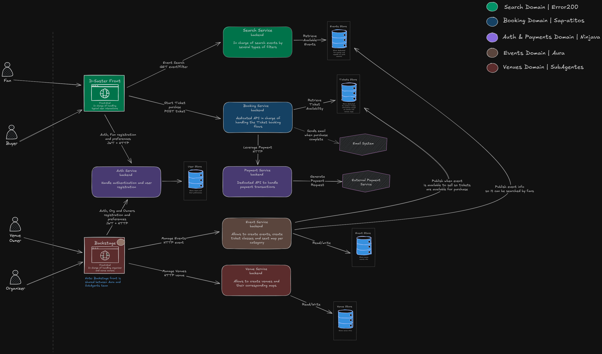
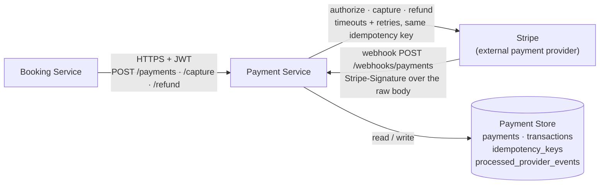

# Architecture — C4 Model

This document describes how the **Payment Service** fits into the overall Ticket D-Saster architecture, using the C4 levels (Context and Containers).

## Level 1 — System Context

At the system level, four types of actors interact with the platform, which in turn depends on two external systems:

- **Actors:** Fan, Buyer, Venue Owner, Organizer.
- **System:** Ticket D-Saster System.
- **External systems:** Payment System, Email System.

The external **Payment System** is precisely the dependency this service encapsulates: the Payment Service is the only part of Ticket D-Saster that talks to it.

## Level 2 — Containers

In the container diagram, the Payment Service sits within the **Auth & Payments Domain** (team *Ninjava*).

### Responsibility at this level

> **Payment Service (backend):** Dedicated API to handle payment transactions.

### Inbound flows

| Source | Via | Description |
|---|---|---|
| `Booking Service` | HTTP (+ propagated JWT) | Leverage Payment: starts the charge for a ticket purchase |
| `External Payment Service` (Stripe) | HTTP webhook, `Stripe-Signature` over the raw body | Reports asynchronous results (`payment_intent.*`, `charge.refunded`) that resolve PENDING payments |

> Frontends (`D-Saster Front`, `Backstage`) do **not** call the Payment Service directly. The purchase flow is orchestrated by the `Booking Service`, which delegates the charge to this service.

### Outbound flows

| Destination | Via | Description |
|---|---|---|
| `External Payment Service` | HTTP | Generate Payment Request to the external provider |
| `Payment Store` | Read/Write | Stores payments, transactions, their status, idempotency keys and the provider events already processed |

> **Note:** the container diagram picture above predates the Payment Store and the
> webhook flow. The text version below is the current container view; use it when the
> picture and this section disagree.

### Webhook flow

1. Stripe sends `POST /webhooks/payments` with the raw body and a `Stripe-Signature`
   header. There is no JWT: the signature is the authentication, and it is verified
   before any status change.
2. The event id is recorded in `processed_provider_events`; a retried delivery is
   acknowledged with `200` and ignored.
3. The payment is resolved by `transactions.provider_reference`. The event is translated
   to a domain status (`AUTHORIZED`, `CAPTURED`, `FAILED` or `REFUNDED`) and only a valid
   transition is applied. Terminal states (`FAILED`, `REFUNDED`) never move, so an
   out-of-order event cannot roll a payment back.
4. The new status and its transaction are persisted together in the `Payment Store`.

### Token consumption

The Payment Service does **not** issue tokens. It trusts the JWT issued by the `Auth Service`, propagated by the `Booking Service` on each request, and only validates its signature and claims (`sub`, `role`) to know on whose behalf the payment is made.

## Design notes

- The purchase confirmation email is sent by the `Booking Service` once the payment completes; the Payment Service only reports the payment result back to Booking.
- As a *Support*-type subdomain, the Payment Service does not contain "core" business logic (such as pricing, seat availability or ticket holds, which belong to Sales/Booking); its complexity lies in **transactional consistency**: idempotency, retries, timeouts, and reconciling asynchronous results (callbacks/webhooks) from the external provider.
- The external provider is accessed through an **adapter** (Anti-Corruption Layer), so it can be replaced without impacting the rest of the service or its consumers.
